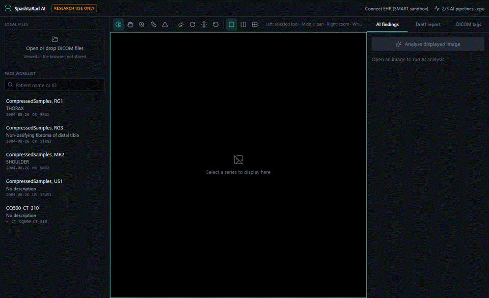
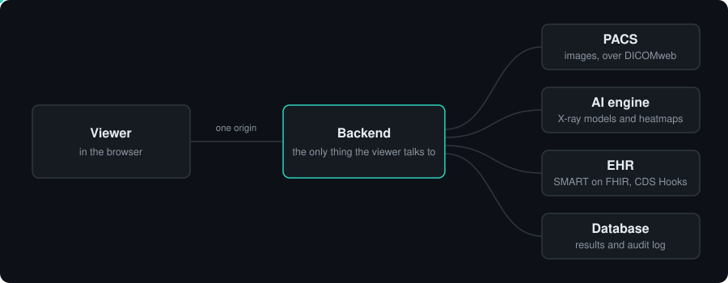
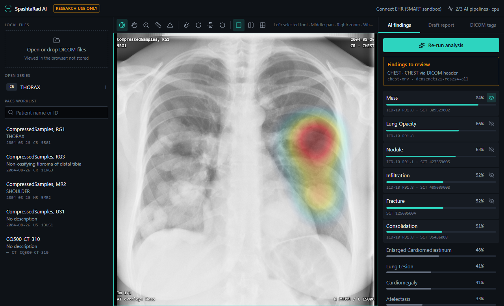
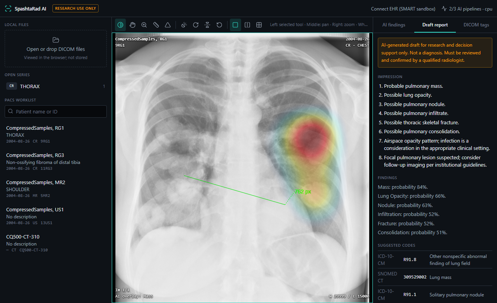
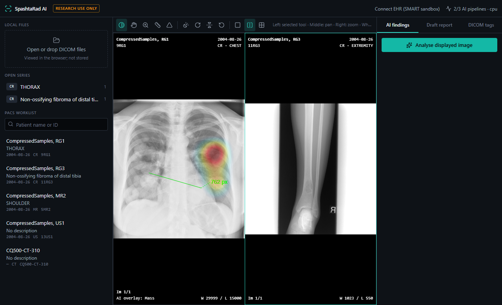
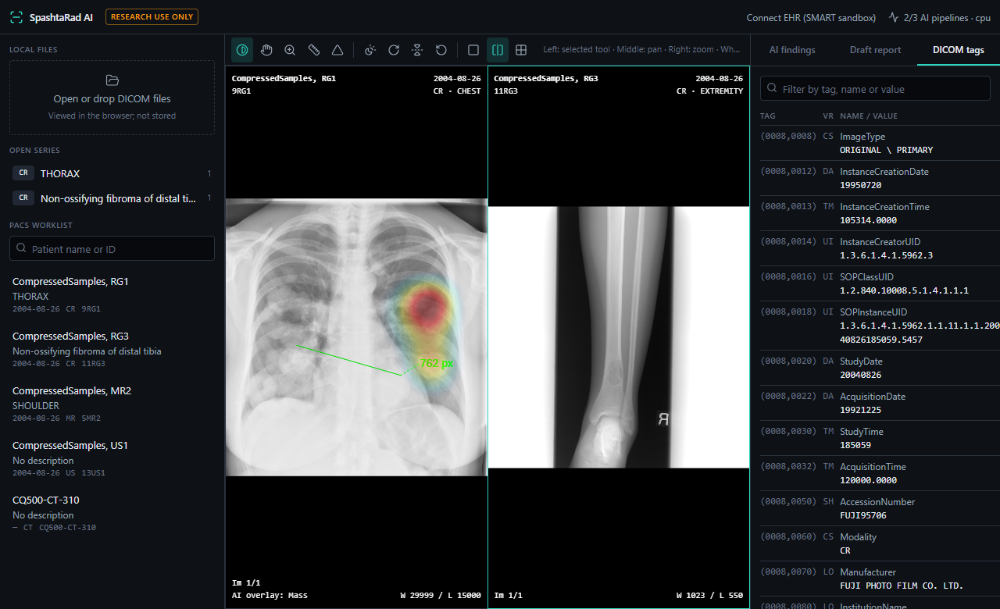

# SpashtaRad

A radiology viewer that shows an X-ray, what an AI model thinks is on it, and where in the image the model was looking.

*Spashta* is Sanskrit for "clear".



> **Research software. Not a medical device.** It has no regulatory clearance and must not be used to diagnose or treat anyone.

## Why

Most AI tools for X-rays hand back a list of probabilities. "Mass: 84%" on its own is hard to trust and hard to check, because you cannot see what the model based it on.

SpashtaRad puts three things next to each other: the image, the model's findings, and a heatmap of the regions that drove each finding. If the heatmap sits on the edge of the film or on a label, you know to ignore the score. If it sits on the lesion you were already looking at, the score means something.

The second reason is plumbing. A viewer that only opens files from a laptop is a demo. Hospitals keep images in a PACS and patients in an EHR, so SpashtaRad speaks the standards those systems speak: DICOMweb for images, SMART on FHIR for launching from a patient's chart, and CDS Hooks for showing a finding inside the EHR.

## How it works



1. You open a study, either from the PACS worklist or by dropping a DICOM file on the page. The image is drawn in the browser by Cornerstone3D.
2. You press **Analyse displayed image**. The backend fetches the image, strips the patient details from its header, and passes it to the AI engine.
3. The engine reads the body part from the DICOM header and picks a model. Chest X-rays go to a TorchXRayVision DenseNet that scores 18 findings. Other X-rays go to BiomedCLIP, which compares the image against short text descriptions.
4. For the strongest findings on a chest X-ray the engine computes a Grad-CAM heatmap. The viewer lays it over the image and keeps it aligned while you zoom, pan, rotate or flip.
5. The findings become a draft report with suggested ICD-10 and SNOMED CT codes. A heatmap can be sent back to the PACS as a new series of the same study.
6. Every analysis, every image retrieval and every read of a result is written to an audit log. Each entry is chained to the previous one by a hash, so a changed or deleted entry can be detected.

The browser never talks to the PACS or the EHR directly. Everything goes through the backend, which holds the credentials and decides what is allowed.

| | |
| --- | --- |
|  |  |
| Findings, each with its own heatmap | Draft report and suggested codes |
|  |  |
| Two studies side by side, with a measurement | The full DICOM header of the open image |

## Where it fits

SpashtaRad sits between the systems a radiology department already has.

- **In front of a PACS.** It reads and writes through DICOMweb (QIDO-RS, WADO-RS, STOW-RS), so it should work with Orthanc, dcm4chee or a cloud DICOM store. So far it has only been run against the small stand-in server in this repository.
- **Next to an EHR.** A clinician can launch the viewer from a patient's chart (SMART on FHIR) and it opens on that patient's studies. The EHR can also ask it for findings while a chart is open (CDS Hooks) and show them as a card.
- **On one machine.** The three parts run on a laptop without a GPU. The first analysis takes about half a minute while the model loads. After that a chest X-ray takes a few seconds.

| Folder | What is in it |
| --- | --- |
| `apps/ai_engine` | The models, the routing by body part, Grad-CAM, and the code that writes a heatmap as a DICOM image |
| `apps/backend` | FastAPI service: PACS gateway, analysis, de-identification, audit log, SMART on FHIR, CDS Hooks |
| `apps/frontend` | The viewer: React, Cornerstone3D, Tailwind |
| `docker` | Compose file for a local Orthanc PACS and an optional PostgreSQL |
| `scripts` | A helper that downloads a few public test images |

## When to use it

Use it to:

- try AI models on X-rays and see what they are reacting to
- learn or teach how a viewer, a PACS and an EHR are wired together with open standards
- start a research prototype without writing the DICOM and FHIR parts yourself

Do not use it to:

- read real patient studies or make any clinical decision
- analyse CT, MR or ultrasound. Those images open and display, but the analysis is refused, because the models were built for X-rays and give confident nonsense on anything else
- judge bone X-rays with any confidence. There is no trained musculoskeletal model in the repository (see the limitations below)

## Running it

You need Python 3.11 or newer and Node.js 22 or newer. Docker is optional. The commands are for PowerShell, from the repository root.

```powershell
# Python: one environment for the engine and the backend
python -m venv .venv
.venv\Scripts\Activate.ps1
pip install torch torchvision --index-url https://download.pytorch.org/whl/cpu
pip install -r apps\ai_engine\requirements.txt
pip install -r apps\backend\requirements-dev.txt

# Viewer
cd apps\frontend; npm install; cd ..\..

# A few public test images, saved to samples\
python scripts\fetch_samples.py
```

Then start three things, each in its own terminal:

```powershell
# 1. A PACS. With Docker:
docker compose -f docker/docker-compose.yml up -d
#    Without Docker, a small in-memory stand-in on the same address and login:
cd apps\backend; python tools\dev_pacs.py ..\..\samples

# 2. The backend
cd apps\backend; uvicorn app.main:app --port 8000

# 3. The viewer
cd apps\frontend; npm run dev
```

Open http://localhost:5173. The worklist on the left shows the studies in the PACS. Pick the chest X-ray and press **Analyse displayed image**.

The PACS is optional. Without one you can still drop a DICOM file on the page and analyse it.

The model weights download the first time they are needed, so the first analysis needs an internet connection.

**Connect EHR (SMART sandbox)** in the top bar launches against the public SMART Health IT sandbox. Any practitioner and any password work there.

The interactive API documentation is at http://localhost:8000/docs.

## Configuration

Every backend setting is an environment variable that starts with `SPASHTA_`, and every one has a default that works for local development. [.env.example](.env.example) lists them all. To change any, copy that file to `apps/backend/.env`.

If you set `SPASHTA_ENVIRONMENT=production`, the backend refuses to start while any of the development shortcuts are still on: the login that trusts everyone, unauthenticated CDS Hooks, the default de-identification key, or a wildcard CORS origin.

## Tests

```powershell
cd apps\ai_engine; pytest; ruff check .     # 26 tests, some of which load the real models
cd apps\backend;   pytest; ruff check .     # 49 tests
cd apps\frontend;  npm test; npm run build  # 9 tests, then a type check and a production build
```

The viewer was also driven through Chrome by script, against both the dev server and the production build: opening files and PACS studies, every toolbar button, measurements, layouts, analysis, the heatmap following a flip and a rotation, and sending a heatmap back to the PACS.

## Limitations

These matter. Please read them before you rely on anything the software shows.

- **The findings have not been validated.** The models are public research models. None of the test images has a confirmed diagnosis, so nothing here says the scores or the heatmap positions are right.
- **No trained model for bones.** There is no freely licensed MURA checkpoint to ship. Until you set `SPASHTA_AI_MSK_WEIGHTS_PATH` to one, bone X-rays fall back to BiomedCLIP, which is much weaker and whose scores are not probabilities.
- **The diagnosis codes are a starting list.** The ICD-10 and SNOMED CT mappings have not been reviewed by a clinical coder, and some findings have no code.
- **De-identification covers the header only.** Names burned into the image itself are not detected.
- **Not yet run against a real PACS.** The PACS features were tested against `tools/dev_pacs.py`, which was written for this project. The Orthanc compose file has not been started.
- **EHR features are tested against sandboxes and test doubles.** The SMART launch works against the public sandbox as a standalone launch. A launch started from inside an EHR, and CDS Hooks called by a real EHR, have not been tried. If the EHR refuses the launch, the user currently sees a raw error message.
- **CDS Hooks authentication is off by default.** Turn it on with `SPASHTA_CDS_AUTH_MODE=jwt` and list each EHR in `SPASHTA_CDS_TRUSTED_CLIENTS` before exposing `/cds-services`. Its replay protection is held in memory, so it only works with a single backend process.
- **The development login trusts every request.** Use `SPASHTA_AUTH_MODE=oidc` anywhere other than your own machine.
- **No database migrations yet.** Tables are created on startup.
